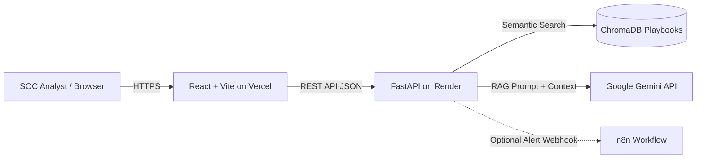

# CyberSage AI — Defensive Incident Triage Assistant

An AI-augmented defensive cybersecurity triage assistant. Security analysts submit suspicious alerts, event data, or raw log excerpts. CyberSage AI performs Retrieval-Augmented Generation (RAG) using curated defensive playbooks in ChromaDB and leverages Google Gemini to output a structured, evidence-based triage assessment with verifiable citations.

## Monorepo Architecture Overview

- **`frontend/`**: Modern React + TypeScript + Vite dashboard with interactive incident triage submission, severity visualization, and source citation inspector.
- **`backend/`**: FastAPI REST API with typed Pydantic models, secure CORS, input sanitization, structured logging, and robust error handling.
- **`knowledge_base/`**: Curated, version-controlled defensive incident response playbooks (e.g., SSH brute force, phishing, malware persistence, unauthorized cloud access).
- **`n8n/`**: Automation workflows and webhook configurations for SIEM / SOC alert notifications.
- **`docs/`**: Architectural specifications, API schemas, deployment runbooks, and demo scripts.
- **`.github/workflows/`**: Continuous Integration (CI) test and lint pipelines.

## Target Deployment Topology

