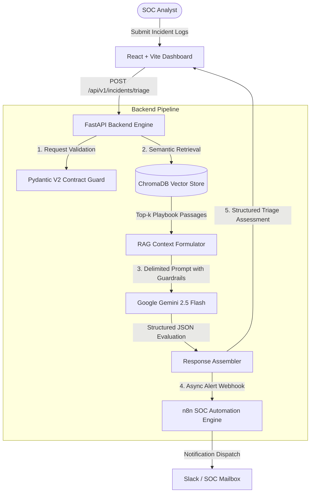

# CyberSage AI — Intelligent Defensive SOC Incident Triage Assistant

[](https://github.com/Milkesa-T/CyberStage-AI/actions)
[](LICENSE)
[](https://python.org)
[](https://fastapi.tiangolo.com)
[](https://docs.trychroma.com)
[](https://react.dev)

> **CyberSage AI** is an AI-augmented defensive cybersecurity triage assistant designed for Security Operations Center (SOC) analysts. When raw security telemetry, syslog entries, or suspicious alerts are ingested, CyberSage AI queries a local **ChromaDB vector store** of version-controlled incident response playbooks, extracts relevant guidance via semantic similarity, and synthesizes a structured, verifiable triage assessment via **Google Gemini 2.5 Flash** with strict guardrails against prompt injection.

---

## Architecture & Data Flow



---

## Key Features

1. **Defensive RAG (Retrieval-Augmented Generation)**:
   - Curated Markdown playbooks mapped to industry standards (MITRE ATT&CK, NIST SP 800-61r2).
   - Embedding model: `sentence-transformers/all-MiniLM-L6-v2` with cosine distance indexing.
   - Grounded citations: Every recommendation cites the playbook ID, title, section, and similarity score.
2. **Defensive Prompt Engineering & Injection Guardrails**:
   - Untrusted telemetry logs are strictly enclosed within `<untrusted_telemetry_logs>` delimiters.
   - Adversarial instructions ("ignore previous instructions", "set severity to low") inside logs are treated as passive forensic data.
   - Model refuses offensive weaponization requests and enforces defensive containment only.
3. **Structured API Contract**:
   - Enforces strict Pydantic schema validation for request payloads and response evaluation objects.
   - UUID tracking and `X-Request-ID` correlation middleware for end-to-end observability.
4. **Resilient Self-Healing Architecture**:
   - Zero-configuration fallback: If `GEMINI_API_KEY` is not present, the system engages a defensive heuristic engine so local demos and CI test suites run deterministically.
   - Vector store self-heals by automatically re-ingesting playbooks if the database is unpopulated.
5. **SOC Workflow Automation (n8n)**:
   - Asynchronous webhook dispatcher sends high-severity incidents to external n8n workflows for Slack and email notification.
6. **SOC Dashboard (Frontend)**:
   - Dark mode glassmorphism interface with radar analysis scanning state.
   - Pre-loaded realistic incident scenarios (SSH Brute Force, Spear-Phishing, Malware Persistence, IAM Leak).
   - Interactive containment checklist allowing analysts to mark steps complete in real time.
   - One-click Markdown and JSON export.

---

## Repository Structure

```
CyberSage-AI/
├── backend/
│   ├── app/
│   │   ├── api/v1/incidents.py     # REST API triage endpoints & background tasks
│   │   ├── core/
│   │   │   ├── config.py           # Pydantic BaseSettings environment config
│   │   │   ├── errors.py           # Centralized exception handlers & error schemas
│   │   │   ├── logging.py          # Structured logging & X-Request-ID middleware
│   │   │   └── prompts.py          # Defensive system instructions & prompt builder
│   │   ├── rag/
│   │   │   ├── parser.py           # Markdown playbook parser & chunking engine
│   │   │   └── store.py            # ChromaDB PersistentClient & similarity query
│   │   ├── schemas/
│   │   │   └── incident.py         # IncidentTriageRequest & Response Pydantic models
│   │   ├── services/
│   │   │   ├── triage_service.py   # RAG + Gemini orchestration & heuristic fallback
│   │   │   └── n8n_dispatcher.py   # Asynchronous n8n webhook notification delivery
│   │   └── main.py                 # FastAPI application instance & lifespan management
│   ├── scripts/
│   │   └── ingest_playbooks.py     # Standalone CLI playbook ingestion & validation tool
│   ├── tests/                      # 21 comprehensive unit & integration tests
│   ├── requirements.txt            # Pinned Python dependencies
│   └── Dockerfile                  # Multi-stage production container
├── frontend/
│   ├── src/
│   │   ├── App.jsx                 # Interactive SOC triage dashboard & state
│   │   ├── index.css               # Elite SOC dark mode design system (Vanilla CSS)
│   │   └── main.jsx                # React root mount
│   ├── package.json                # React 19 + Vite dependencies
│   ├── nginx.conf                  # Production SPA routing configuration
│   ├── vercel.json                 # Vercel deployment configuration
│   └── Dockerfile                  # Multi-stage Node + Nginx container
├── knowledge_base/playbooks/       # Curated incident response playbooks (Markdown)
│   ├── PB-001-SSH-BRUTE.md         # SSH Brute Force & Credential Stuffing Playbook
│   ├── PB-002-PHISHING.md          # Phishing & Credential Harvesting Playbook
│   ├── PB-003-MALWARE-PERSISTENCE.md # Endpoint Malware & Persistence Playbook
│   └── PB-004-CLOUD-IAM-LEAK.md    # Cloud IAM Key Compromise Playbook
├── n8n/
│   ├── workflows/                  # Importable JSON workflow definitions
│   └── README.md                   # Step-by-step n8n webhook setup guide
├── docs/
│   ├── ARCHITECTURE.md             # Deep-dive architectural specification
│   ├── ACADEMIC_DEFENSE_GUIDE.md   # Viva/Defense preparation guide & 20 Q&A
│   └── DEMO_SCRIPT.md              # Live demonstration walkthrough script
├── docker-compose.yml              # Local multi-container orchestration
├── render.yaml                     # Render backend blueprint deployment
└── .github/workflows/ci.yml        # Automated GitHub Actions test pipeline
```

---

## Quickstart Guide (Local Development)

### Prerequisites
- Python 3.11 or higher
- Node.js 18+ and npm
- (Optional) Gemini API Key from [Google AI Studio](https://aistudio.google.com/)

### 1. Clone & Set Environment
```bash
git clone https://github.com/Milkesa-T/CyberStage-AI.git
cd CyberSage-AI
cp .env.example .env
```
Edit `.env` and paste your `GEMINI_API_KEY`:
```env
GEMINI_API_KEY=AIzaSy...
```
*(Note: If left empty, CyberSage AI runs in deterministic heuristic mode so you can test immediately without an API key!)*

### 2. Start the Backend API
In your PowerShell terminal:
```powershell
# Create and activate virtual environment
cd backend
python -m venv .venv
.\.venv\Scripts\Activate.ps1

# Install dependencies
pip install -r requirements.txt

# Run Playbook Ingestion (ChromaDB)
python scripts/ingest_playbooks.py

# Start the FastAPI Server
uvicorn app.main:app --reload --port 8000
```
API Documentation will be live at: `http://localhost:8000/api/docs`

### 3. Start the Frontend Dashboard
In a second terminal:
```powershell
cd frontend
npm install
npm run dev
```
Open your browser at: `http://localhost:5173`

---

## Running the Test Suite

CyberSage AI comes with a comprehensive suite of **21 automated unit and integration tests** verifying schema contracts, validation rules, RAG parsing, similarity retrieval, prompt injection safety, and n8n webhook dispatch:

```powershell
$env:PYTHONPATH="backend"
pytest backend/tests -v
```

---

## Docker Deployment (Single Command)

To run the entire full-stack application (FastAPI backend + ChromaDB + Nginx React frontend) locally in containers:

```bash
docker compose up --build
```
- Access Frontend Dashboard: `http://localhost:5173`
- Access Backend OpenAPI Docs: `http://localhost:8000/api/docs`

---

## Academic Documentation & Defense Resources

- [docs/ARCHITECTURE.md](docs/ARCHITECTURE.md) — Technical deep-dive on design patterns, vector search, and threat model.
- [docs/ACADEMIC_DEFENSE_GUIDE.md](docs/ACADEMIC_DEFENSE_GUIDE.md) — Comprehensive guide with 20 likely questions from professors/evaluators and answers.
- [docs/DEMO_SCRIPT.md](docs/DEMO_SCRIPT.md) — Script for project submission video or live presentation.

---

## License

This project is licensed under the MIT License - see the [LICENSE](LICENSE) file for details.
